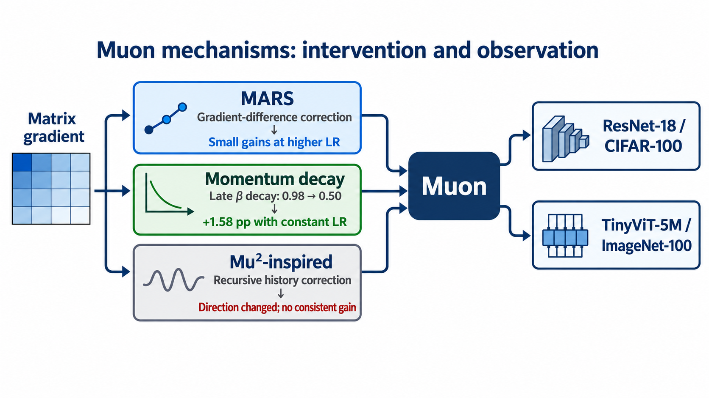

# Underexplored Mechanisms in Muon

This repository is the cleaned public snapshot of our controlled Muon ablation project. It contains the code and frozen configurations used for the final ResNet-18/CIFAR-100 and TinyViT-5M/ImageNet-100 experiments, plus compact result tables and presentation material.

The project studies three interventions on the matrix-parameter path:

1. a MARS-inspired consecutive-gradient correction;
2. scheduling Muon's momentum coefficient;
3. a secondary direction estimator inspired by Mu²SGD.

The goal is mechanism isolation, not a claim that one combined optimizer is universally best.



## Main observations

- **MARS:** small improvements in selected higher-LR conditions. The best clean ResNet comparison was `+0.46 ± 0.22` percentage points at matrix LR `0.04` and gamma `0.25`.
- **Momentum decay:** the clearest result. On TinyViT at constant matrix LR `0.0025`, changing beta from `0.98` to `0.50` during epochs `36-48` improved the matched endpoint by `+1.58 ± 0.33` points.
- **LR interaction:** the same late momentum schedule did not improve the endpoint under cosine LR, where the matched change was `-0.31 ± 0.31` points.
- **Mu²-inspired estimator:** it changed update directions but did not provide a consistent accuracy gain.
- **Combinations:** MARS and momentum decay can coexist, but the measured benefits were not reliably additive.

## Repository layout

```text
configs/                 frozen final experiment grids
docs/                    canonical experiment design and reproduction notes
figures/                 selected final result figures
handoff/                 slides, English summary, and overview diagram
results/                 compact seed-level and aggregated CSV tables
scripts/                 scripts used to aggregate and plot the final results
src/dataset/             CIFAR-100 and ImageNet-100 loaders
src/model/               ResNet-18 and timm TinyViT-5M builders
src/optim/               only the six Muon-family implementations used here
src/trainer/             training and evaluation loop
run_experiment_suite.py  multi-seed experiment runner
```

Historical tar archives, abandoned optimizer variants, proxy models, CIFAR-100N experiments, temporary recovery configs, cluster logs, and machine-specific launch scripts were intentionally removed.

## Fixed training contract

- rank-2-or-higher tensors use the Muon-side update;
- lower-dimensional tensors use the same auxiliary AdamW branch in every run;
- auxiliary AdamW: LR `1e-3`, betas `(0.9, 0.999)`, epsilon `1e-8`, zero weight decay;
- Muon matrix weight decay: `5e-4`;
- Nesterov direction enabled, five Newton-Schulz steps;
- batch size `128`, 50 epochs, global gradient clipping at `1.0`;
- seeds `42`, `43`, and `44` for the claim-defining confirmations.

The complete experiment taxonomy is in [docs/EXPERIMENTS.md](docs/EXPERIMENTS.md).

## Setup

```bash
python -m venv .venv
source .venv/bin/activate
pip install -r requirements.txt
```

On Windows, activate with `.venv\Scripts\activate`.

Place CIFAR-100 under `./data` or allow torchvision to download it. Place the Kaggle ImageNet-100 dataset under `./data/imagenet100` with `train/` and `val/` subdirectories. Dataset roots can also be changed directly in a frozen configuration.

## Run a frozen grid

List the cells in a grid:

```bash
python run_experiment_suite.py --config configs/resnet18_lr_grid.json --list
```

Run selected cells on seeds 42, 43, and 44:

```bash
python run_experiment_suite.py \
  --config configs/resnet18_lr_grid.json \
  --experiments <experiment-name> \
  --seeds 42-44 \
  --keep-seed-results
```

For TinyViT, substitute one of the `tinyvit_*.json` grids. W&B logging is disabled in the public configs and can be enabled explicitly with `--wandb`.

## Public artifacts

- [English project summary](handoff/Muon_Project_English_Summary.pdf)
- [Presentation slides](handoff/Muon_Project_Slides_English.pptx)
- [One-picture overview](handoff/Muon_Project_Visual_Summary.png)

## Scope

The experiments cover two vision workloads, 50-epoch training, broad seed-42 exploration, and targeted three-seed confirmation. Seed 42 also participated in exploration. The evidence supports a focused optimizer-design case study rather than universal superiority claims.
